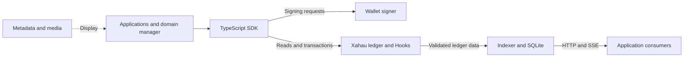

# Architecture and source guide

XahauName combines a native on-chain name service, a TypeScript SDK, a ledger indexer and a wallet-connected domain manager. This guide explains the boundaries between them and points to the code that implements each flow.

## System overview



The ledger holds domain state and native URIToken custody. The SDK encodes operations, verifies identities and confirms receipts. Wallets authorize transactions. The indexer builds queryable copies and events from validated ledger data. Metadata supplies presentation without deciding ownership.

Network transport and deployment identity are separate: [networks.ts](../packages/sdk/src/networks.ts) defines transport profiles, while [deployments.ts](../packages/sdk/src/deployments.ts) supplies a public deployment preset. See [network configuration](NETWORKS.md) for selecting another deployment.

## Domain identity and records

A canonical name maps to a full native URIToken ID. The token ID is derived from its issuer and exact immutable URI; a stored forward map preserves the association when URIBase changes for future registrations. Reverse mappings support name discovery from a token.

The domain's root contains its owner, flags and initial-claim timestamp. Separate state keys hold addresses, texts, the bounded record index and primary selections. Custom text slots retain both the full state key and its original name, so records can be enumerated and cleaned.

| Source | Responsibility |
| --- | --- |
| [common.h](../hook/src/common.h) | State layouts, key builders, parsers, indices and lifecycle journal |
| [identity.ts](../packages/sdk/src/identity.ts) | Verify domain/token association and native issuer |
| [util.ts](../packages/sdk/src/util.ts) | SDK key derivation and binary state decoding |
| [addresses.ts](../packages/sdk/src/addresses.ts) | Human receiving-address codecs |
| [text-records.ts](../packages/sdk/src/text-records.ts) | Typed profile-field conventions |
| [content.ts](../packages/sdk/src/content.ts) | IPFS URI and contenthash conversion |

The [state reference](SPEC.md#5-state) defines exact bytes. The [XNIP registry](standards/README.md#registry) describes application conventions built on that storage.

## Registration and claim

1. [RegistrarModule](../packages/sdk/src/registrar.ts) reads pricing and submits the registration Payment through the configured signer.
2. [issuance.c](../hook/src/handlers/issuance.c) validates the request, reserves identity/pending state and emits URITokenMint.
3. Its callback reads the emitted result from transaction/metadata slots and emits a restricted zero-price sell offer after mint succeeds.
4. The recipient signs URITokenBuy. [claim.c](../hook/src/handlers/claim.c) enters shared lifecycle processing to finalize root ownership.
5. [receipts.ts](../packages/sdk/src/receipts.ts) checks validated results and expected handler acknowledgement; the registrar then verifies final registration status.

```ts
const result = await client.registrar.buyAndClaim({label: 'alice', tld: 'xah'});
console.log(result.status.stage, result.status.owner);
```

Here `client` is a connected SDK client with a signer for the recipient. Purchase and claim remain two consent events; [purchase.ts](../packages/sdk/src/purchase.ts) and the [application purchase flow](../test-app/src/purchase.ts) coordinate their presentation.

## Record updates and transfer

[ResolverModule](../packages/sdk/src/resolver.ts) validates typed input and builds native HookParameters using [protocol.ts](../packages/sdk/src/protocol.ts). The signer approves an Invoke addressed to the treasury; a treasury-originated Invoke targets its own hook chain.

```ts
await client.resolver.setProfile({
  label: 'alice', tld: 'xah',
  set: {description: 'Builder on Xahau', url: 'https://example.com'},
  clear: ['notice'],
});
```

This uses the profile mask format and one atomic Invoke. [authorization.c](../hook/src/handlers/authorization.c) verifies root/native ownership within the strong transaction, and [profile.c](../hook/src/handlers/profile.c) applies the field changes. An ownership or write rejection rolls back the transaction's provisional record changes. The [handler guide](../hook/README.md#handler-responsibilities) maps other operations to their C modules.

Transfers use a directed native sell offer and recipient acceptance. Accepted transfer clears previous address/text/custom records and primary selection; creating an offer alone does not change ownership. [burn.c](../hook/src/handlers/burn.c) shares lifecycle cleanup for native token deletion. [control.c](../hook/src/handlers/control.c) implements reset and primary selection.

Weak native lifecycle processing and strong reconciliation are distinct phases. The shared journal preserves cleanup provenance, and `registrar.reconcile(domain)` requests a strong Invoke against native custody/existence. The [lifecycle specification](SPEC.md#10-lifecycle-reconciliation-testnet) defines the contract; [verification records](review/README.md) describe the evidence for each execution environment.

## SDK

The public entry point is [src/index.ts](../packages/sdk/src/index.ts). It owns connection/configuration, the optional signer, caching and module construction.

| Module | Source |
| --- | --- |
| Registrar | [registrar.ts](../packages/sdk/src/registrar.ts) |
| Resolver | [resolver.ts](../packages/sdk/src/resolver.ts) |
| Administrative controls | [controller.ts](../packages/sdk/src/controller.ts) |
| Wallet session/signing adapter | [wallet-kit.ts](../packages/sdk/src/wallet-kit.ts) |
| Confirmation and receipt matching | [confirmation.ts](../packages/sdk/src/confirmation.ts), [receipts.ts](../packages/sdk/src/receipts.ts) |
| Metadata and avatars | [metadata.ts](../packages/sdk/src/metadata.ts), [index.ts](../packages/sdk/src/index.ts) |
| Indexed HTTP reads | [indexer.ts](../packages/sdk/src/indexer.ts) |
| Public contracts | [types.ts](../packages/sdk/src/types.ts), [context.ts](../packages/sdk/src/context.ts) |

The [quickstart](../packages/sdk/README.md#quickstart) shows integration code; [API.md](API.md) describes the complete methods and result contracts.

[read-profile.mjs](examples/read-profile.mjs) demonstrates a complete client lifecycle with related reads pinned to one ledger hash. [read-events.mjs](examples/read-events.mjs) consumes the indexer's cursor-based HTTP API. See [example configuration](examples/README.md).

## Indexer

```text
Validated snapshot/ledger
  -> source.ts
  -> decoder.ts: committed state/token changes and events
  -> projection.ts: domain profiles and consistency checks
  -> storage.ts: one atomic ledger commit
  -> public queries and cursor-based event delivery
```

[index.ts](../packages/indexer/src/index.ts) orchestrates bootstrap, ordered replay and checkpoint advancement. [source.ts](../packages/indexer/src/source.ts) supplies pinned snapshots and expanded validated ledgers. [decoder.ts](../packages/indexer/src/decoder.ts) checks deployment/namespace identity and reads committed metadata; [projection.ts](../packages/indexer/src/projection.ts) constructs domain views. [storage.ts](../packages/indexer/src/storage.ts) persists the projection, receipts, checkpoint and outbox together.

Events such as DomainClaimed, DomainTransferred and DomainBurned are derived application events, separate from native token changes. The [HTTP/SSE example](../packages/indexer/examples/server.cjs) serves queries and resumable event delivery. See the [indexer reference](INDEXER.md) for schema and operational behavior.

## Domain manager

[main.ts](../test-app/src/main.ts) starts [app.ts](../test-app/src/app.ts), which coordinates Wallet Kit, navigation, dialogs and SDK calls. [views.ts](../test-app/src/views.ts) renders domain cards and record forms. [config.ts](../test-app/src/config.ts), [wallet-signer.ts](../test-app/src/wallet-signer.ts) and [wallet-balance.ts](../test-app/src/wallet-balance.ts) connect network selection, signing and balance display.

Domain actions use the SDK rather than implementing hook-state layouts in the UI. [records.ts](../test-app/src/records.ts) defines receiving-network/profile presets; [metadata.ts](../test-app/src/metadata.ts) handles presentation fetching. See the [application README](../test-app/README.md#source-guide) for the full source map.

## Build and package boundaries

The root [package.json](../package.json) declares client workspaces. [check-packages.mjs](../scripts/check-packages.mjs) builds/checks their distributions, while [build-hooks.mjs](../scripts/build-hooks.mjs) and [test-hooks.mjs](../scripts/test-hooks.mjs) operate on native WASM artifacts. Browser hosting is a separate application build.

The treasury manages deployment and protocol configuration, including pricing, enabled TLDs, pause and URIBase. The installed burn handler permits only the native token Owner to burn; it rejects issuer burns after custody leaves the treasury. Tokens retain their native burnable flag for strong Buy/Remit validation, so removing this protection through an upgrade would restore native issuer permission. [SPEC.md](SPEC.md#1-identity-and-authority) documents these authority boundaries. [CONTRIBUTING.md](../CONTRIBUTING.md), [package maintenance](PACKAGES.md) and [review records](review/README.md) cover changes and verification.
